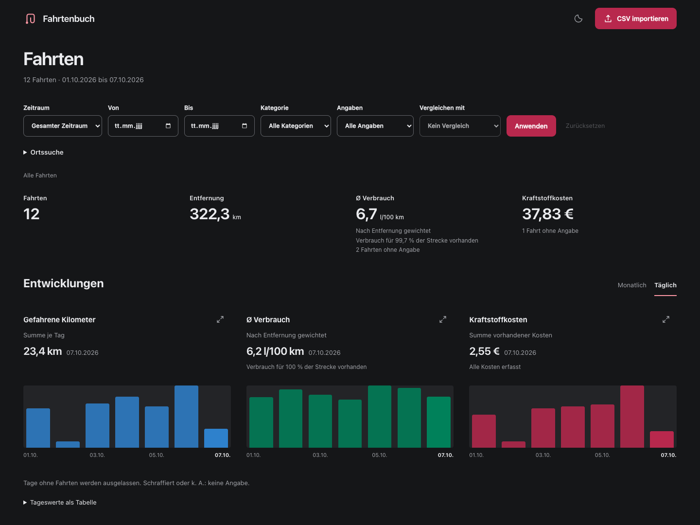

# Fahrtenbuch

A self-hosted trip archive for collecting CSV exports, finding journeys, and understanding distance, fuel consumption, and costs over time.

**The interface is in German. The importer currently supports the German MyPeugeot CSV format.** Fahrtenbuch is intended for one vehicle and one user on a private network or VPN; it has no authentication.



## Features

- Import and archive CSV-files without duplicate trips.
- Explore daily and monthly charts, enlarge them, and compare with the previous period or year.
- Inspect odometer readings, map endpoints, and explicitly reconstructed routes.
- Filter by date, category, missing values, or proximity to a start or destination; sort all table columns.
- Review changes to known trips before accepting them.
- Correct category, consumption, and cost while retaining imported values - calculated suggestions are provided where possible.
- Use the responsive interface with a keyboard, or choose system, light, or dark appearance.

## Run with Docker

Install Docker with Compose, then download or clone this repository. In its directory, run:

```sh
mkdir -p data
export DOCKER_USER="$(id -u):$(id -g)"
docker compose up -d --build
```

Open [localhost:3000](http://localhost:3000), select your CSV, and click **Fahrten importieren**. Bun is included in the image; no separate database service is needed.

The default binding allows access only from the Docker host. To make it reachable on your private network or VPN, set `BIND_ADDRESS=0.0.0.0` before starting it and open `http://HOST-IP:3000`. Keep access restricted to trusted devices.

All archive data lives in `./data`, outside the container. Keep this directory when updating or recreating the container.

## Data and maps

Imported values are retained, including missing or unusual values. Corrections are stored separately. Average consumption is weighted by distance, with coverage shown for missing values. Calculated suggestions require explicit confirmation.

Maps load OpenStreetMap tiles. Opening a suitable trip can send its start and destination coordinates to the configured routing service. Reconstructed routes are estimates, not recorded GPS tracks.
